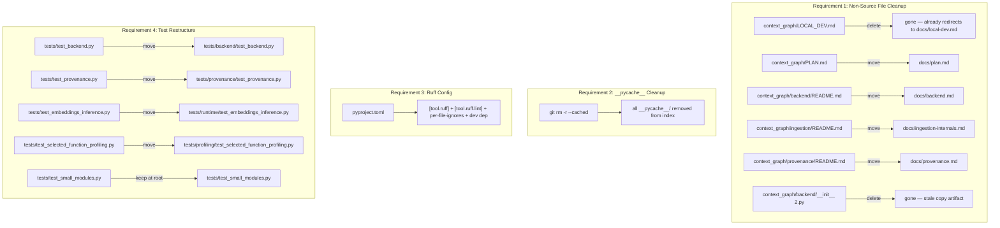

# Design Document: Phase 2 Cleanup

## Overview

This design covers four scoped repository-hygiene tasks for the `context_graph` project:

1. Remove non-source files (`.md`, stale `.py` copies) from the `context_graph/` Python package
2. Remove tracked `__pycache__/` directories from Git history
3. Add a `ruff` linting configuration to `pyproject.toml`
4. Restructure the flat `tests/` directory to mirror the source package layout

All changes are file-level operations, git index commands, config additions, and file moves. No runtime code is modified.

## Architecture

These are repository-level housekeeping operations. There is no new architecture — the changes affect:

- The file tree (deletions, moves)
- The Git index (`git rm --cached`)
- `pyproject.toml` (new `[tool.ruff]` sections, new dev dependency)
- The `tests/` directory structure (subdirectories mirroring `context_graph/` sub-packages)



## Components and Interfaces

### Requirement 1: Non-Source File Cleanup

| File | Action | Rationale |
|------|--------|-----------|
| `context_graph/LOCAL_DEV.md` | Delete | Content is a redirect stub pointing to `docs/local-dev.md`. No unique information. |
| `context_graph/PLAN.md` | Move → `docs/plan.md` | Contains the project vision document. Valuable but does not belong in an installable package. |
| `context_graph/backend/README.md` | Move → `docs/backend.md` | Detailed backend interface documentation. Belongs in `docs/`. |
| `context_graph/ingestion/README.md` | Move → `docs/ingestion-internals.md` | The existing `docs/ingestion.md` is a brief CLI-focused overview. The package README adds substantial internal architecture detail (module responsibilities, end-to-end flow, reading order). Content is complementary, not redundant. |
| `context_graph/provenance/README.md` | Move → `docs/provenance.md` | Comprehensive provenance pipeline documentation. Belongs in `docs/`. |
| `context_graph/backend/__init__ 2.py` | Delete | Stale copy artifact (note the space in the filename). Not a valid Python module. |

After cleanup, `context_graph/` contains only `.py` files.

### Requirement 2: __pycache__ Cleanup

The `.gitignore` already contains `__pycache__/` and `*.py[cod]` entries — no changes needed there.

Tracked `__pycache__/` directories exist under:
- `__pycache__/` (repo root)
- `tests/__pycache__/`
- `context_graph/__pycache__/`
- `context_graph/backend/__pycache__/`
- `context_graph/backend/metadata/__pycache__/`
- `context_graph/backend/neo4j/__pycache__/`
- `context_graph/backend/neptune/__pycache__/`
- `context_graph/backend/profile_vectors/__pycache__/`
- `context_graph/code_identity/__pycache__/`
- `context_graph/ingestion/__pycache__/`
- `context_graph/ingestion/git/__pycache__/`
- `context_graph/memory/__pycache__/`
- `context_graph/memory/prompts/__pycache__/`
- `context_graph/models/__pycache__/`
- `context_graph/profiling/__pycache__/`
- `context_graph/provenance/__pycache__/`
- `context_graph/provenance/prompts/__pycache__/`
- (and any others visible in the tree)

Command pattern:
```bash
git rm -r --cached __pycache__/ tests/__pycache__/ context_graph/**/__pycache__/
```

Or more robustly:
```bash
find . -type d -name __pycache__ -exec git rm -r --cached {} + 2>/dev/null
```

The `.gitignore` entries are preserved as-is.

### Requirement 3: Ruff Configuration

Add to `pyproject.toml`:

```toml
[tool.ruff]
target-version = "py310"
line-length = 120

[tool.ruff.lint]
select = ["E", "F", "I"]

[tool.ruff.lint.per-file-ignores]
"tests/**" = ["E501"]
"tests/**/conftest.py" = ["F401"]
```

Design decisions:
- `target-version = "py310"` matches `requires-python = ">=3.10,<4"`.
- `line-length = 120` — the existing codebase uses lines well beyond 88/100 chars (test files routinely exceed 100). 120 is a pragmatic fit.
- Rule prefixes: `E` (pycodestyle errors), `F` (pyflakes), `I` (isort) — the minimum required set.
- `E501` suppressed in tests — test assertions and mock setups commonly use long lines.
- `F401` suppressed in conftest files — fixtures are imported for side effects.

Add `ruff` to the dev dependency group:
```toml
[dependency-groups]
dev = [
    "pytest>=9,<10",
    "pytest-cov>=7,<8",
    "pydantic-settings>=2.10,<3",
    "pyyaml>=6,<7",
    "ruff>=0.11,<1",
]
```

### Requirement 4: Test Restructure

Current flat layout:
```
tests/
  conftest.py
  test_backend.py
  test_embeddings_inference.py
  test_provenance.py
  test_selected_function_profiling.py
  test_small_modules.py
```

Target layout:
```
tests/
  conftest.py                              # shared fixtures — stays at root
  test_small_modules.py                    # cross-cutting (runtime, query, CLI) — stays at root
  backend/
    __init__.py
    test_backend.py                        # covers context_graph/backend/ and context_graph/ingestion/
  provenance/
    __init__.py
    test_provenance.py                     # covers context_graph/provenance/
  runtime/
    __init__.py
    test_embeddings_inference.py           # covers context_graph/runtime/ embedding settings
  profiling/
    __init__.py
    test_selected_function_profiling.py    # covers context_graph/profiling/
```

Design decisions:
- `test_backend.py` imports from `context_graph.backend`, `context_graph.ingestion`, `context_graph.models`, `context_graph.profile_vectors`, and `context_graph.query`. The dominant coverage is backend + ingestion. Placing it under `tests/backend/` is the best fit per the requirements.
- `test_small_modules.py` covers `context_graph.query.parser`, `context_graph.runtime.embeddings`, `context_graph.runtime.llm_config`, `context_graph.runtime.tracing`, and MCP config. It is genuinely cross-cutting and stays at root.
- Each new subdirectory gets an empty `__init__.py` for pytest discovery.
- The root `conftest.py` is preserved. No subdirectory-specific conftest files are needed since the test files are self-contained with their own fixtures.
- No test code is modified — only file locations change.
- `pytest tests/` continues to discover all tests. `pytest tests/provenance/` runs only provenance tests.

## Data Models

No new data models are introduced. These are file-system and configuration changes only.


## Correctness Properties

*A property is a characteristic or behavior that should hold true across all valid executions of a system — essentially, a formal statement about what the system should do. Properties serve as the bridge between human-readable specifications and machine-verifiable correctness guarantees.*

Most acceptance criteria in this spec are concrete file operations (move file X to Y, delete file Z) and are best validated as specific examples. Three criteria generalize into universal properties:

### Property 1: Package purity

*For any* file path under the `context_graph/` directory tree, the file extension must be `.py`. No `.md`, `.yml`, `.txt`, or other non-source files shall exist in the installable package.

**Validates: Requirements 1.7**

### Property 2: Git index cleanliness

*For any* path tracked in the Git index, the path shall not contain `__pycache__` as a directory component and shall not end with `.pyc`, `.pyo`, or `.pyd`.

**Validates: Requirements 2.2, 2.3, 2.4**

### Property 3: Test subdirectory discovery

*For any* immediate subdirectory of `tests/` that contains at least one `test_*.py` file, that subdirectory shall also contain an `__init__.py` file to ensure pytest discovery works correctly.

**Validates: Requirements 4.7**

## Error Handling

These are file-system and configuration changes with minimal error surface:

- **File not found**: If any of the files listed in Requirement 1 have already been moved or deleted, the corresponding task should be skipped (idempotent).
- **Git rm on untracked paths**: `git rm --cached` on paths not in the index will produce a warning. Use `--ignore-unmatch` or check tracking status first.
- **TOML syntax**: Malformed additions to `pyproject.toml` would break `uv sync` and `pytest`. Validate by running `python -c "import tomllib; tomllib.load(open('pyproject.toml','rb'))"` after editing.
- **Test discovery**: If `__init__.py` files are missing from new test subdirectories, pytest may fail to discover tests. Verify with `pytest --collect-only tests/`.

## Testing Strategy

### Unit / Example Tests

Since most acceptance criteria are concrete file operations, validation is primarily example-based:

- Verify each moved file exists at its destination and not at its source
- Verify each deleted file no longer exists
- Verify `.gitignore` still contains `__pycache__/` and `*.py[cod]`
- Parse `pyproject.toml` and verify `[tool.ruff]`, `[tool.ruff.lint]`, `[tool.ruff.lint.per-file-ignores]` sections exist with expected values
- Verify `ruff` appears in the dev dependency group with a version constraint
- Verify `tests/conftest.py` exists at root
- Verify `tests/test_small_modules.py` exists at root
- Run `pytest tests/` and confirm all tests pass (exit code 0)
- Run `pytest tests/provenance/` and confirm targeted discovery works

### Property-Based Tests

Property-based testing library: **Hypothesis** (Python)

Each property test should run a minimum of 100 iterations. Since these properties operate over file trees and git index state (not randomly generated inputs), they are better expressed as exhaustive directory-walk assertions rather than traditional PBT with random generation. However, the properties are still universally quantified and can be validated by enumerating all members of the relevant set.

- **Feature: phase2-cleanup, Property 1: Package purity** — Walk all files under `context_graph/` and assert every file has a `.py` extension.
- **Feature: phase2-cleanup, Property 2: Git index cleanliness** — List all paths in the git index and assert none contain `__pycache__` or end with `.pyc`/`.pyo`/`.pyd`.
- **Feature: phase2-cleanup, Property 3: Test subdirectory discovery** — For each subdirectory of `tests/` containing `test_*.py` files, assert `__init__.py` exists.

These three properties are exhaustive checks over finite sets (all package files, all git index entries, all test subdirectories) and serve as post-condition guards that the cleanup was applied correctly.
