# Design Document: Phase 3 Package Hygiene

## Overview

This design addresses five structural hygiene issues in the `context_graph` Python package discovered during a post-phase-2 audit:

1. **Broken `_EXPORTS` paths** — 8 entries in `context_graph/__init__.py` reference `.storage.backend.*` modules that don't exist (the correct prefix is `.backend.*`).
2. **Misplaced `memory/` package** — `context_graph/memory/` contains only prompt types and helpers. The name is misleading; contents belong under `context_graph/prompts/`.
3. **Duplicate `_arg_or_env` helper** — Two near-identical copies exist in `runtime/embeddings.py` and `runtime/llm_config.py` with a subtle behavioral divergence.
4. **Fragile `BedrockLLMClient` export** — `runtime/llm/__init__.py` unconditionally lists `BedrockLLMClient` in `__all__` but only conditionally imports it, causing `import *` to advertise an inaccessible symbol when `boto3` is absent.
5. **Dev-only `profiling/` shipped as production code** — `context_graph/profiling/` pulls in heavyweight imports and is only used by dev scripts/tests.

All changes are refactoring-only: no new features, no behavioral changes to public APIs.

## Architecture

```mermaid
graph TD
    subgraph "Req 1: Fix _EXPORTS"
        A1[".storage.backend.metadata"] -->|replace| B1[".backend.metadata"]
        A2[".storage.backend.profile_vectors"] -->|replace| B2[".backend.profile_vectors"]
    end

    subgraph "Req 2: Relocate memory/"
        C1["context_graph/memory/prompts/models.py"] -->|move| D1["context_graph/prompts/models.py"]
        C2["context_graph/memory/prompts/prompt_helpers.py"] -->|move| D2["context_graph/prompts/prompt_helpers.py"]
        C3["context_graph/memory/"] -->|delete| X1["removed"]
    end

    subgraph "Req 3: Extract _arg_or_env"
        E1["embeddings.py::_arg_or_env"] -->|extract| F1["runtime/_env_utils.py"]
        E2["llm_config.py::_arg_or_env"] -->|extract| F1
    end

    subgraph "Req 4: Harden LLM __init__"
        G1["__all__ unconditional BedrockLLMClient"] -->|fix| G2["__all__ += on successful import"]
    end

    subgraph "Req 5: Move profiling/"
        H1["context_graph/profiling/"] -->|move| H2["tools/profiling/"]
        H3["context_graph/profiling/"] -->|delete| X2["removed from package"]
    end
```



## Components and Interfaces

### Requirement 1: Fix broken `_EXPORTS` paths

The `_EXPORTS` dictionary in `context_graph/__init__.py` has 8 entries referencing `.storage.backend.*` — a module path that doesn't exist. The actual modules live under `.backend.*`.

| Current (broken) path | Corrected path | Affected symbols |
|---|---|---|
| `.storage.backend.metadata` | `.backend.metadata` | `AuroraMetadataStore`, `InMemoryMetadataStore`, `RepoIndexState`, `RepoSourceState`, `SQLiteMetadataStore` |
| `.storage.backend.profile_vectors` | `.backend.profile_vectors` | `AuroraProfileVectorStore`, `InMemoryProfileVectorStore`, `ProfileVectorHit` |

The fix is a direct string replacement in the `_EXPORTS` dict. No other files reference `.storage.backend`.

### Requirement 2: Relocate `memory/` package to `prompts/`

The `context_graph/memory/` package contains only two leaf modules under `memory/prompts/`:
- `models.py` — `Message`, `PromptVersion`, `PromptFunction` types
- `prompt_helpers.py` — `to_prompt_json`, `DO_NOT_ESCAPE_UNICODE`

The intermediate `memory/prompts/` nesting is unnecessary. The target structure flattens to:

```
context_graph/prompts/
    __init__.py
    models.py
    prompt_helpers.py
```

10 files import from `context_graph.memory.prompts`:

| File | Imports `models.Message` | Imports `prompt_helpers.*` |
|---|---|---|
| `runtime/llm/client.py` | ✓ | |
| `runtime/llm/openai_base_client.py` | ✓ | |
| `runtime/llm/bedrock_client.py` | ✓ | |
| `provenance/services.py` | ✓ | |
| `provenance/prompts/base.py` | ✓ | |
| `provenance/prompts/extract_claims_and_evidence.py` | ✓ | ✓ |
| `provenance/prompts/normalize_claims.py` | ✓ | ✓ |
| `provenance/prompts/relate_claims.py` | ✓ | ✓ |
| `provenance/prompts/resolve_fact_conflicts.py` | ✓ | ✓ |
| `provenance/prompts/synthesize_research_artifact.py` | ✓ | ✓ |

All imports change from `context_graph.memory.prompts.models` → `context_graph.prompts.models` and `context_graph.memory.prompts.prompt_helpers` → `context_graph.prompts.prompt_helpers`.

After relocation, the entire `context_graph/memory/` directory tree is deleted.

### Requirement 3: Extract shared `_arg_or_env`

Two copies exist with a subtle difference:

```python
# embeddings.py — stricter check
if value is not None and str(value):
    return str(value)

# llm_config.py — truthy check
if value:
    return str(value)
```

The `embeddings.py` version is more correct: it distinguishes `None` from falsy-but-valid values (e.g., `0` or empty string from argparse). The canonical version in `runtime/_env_utils.py` will use the `embeddings.py` semantics (`value is not None and str(value)`).

Both modules will import from the new shared location:
```python
from context_graph.runtime._env_utils import _arg_or_env
```

### Requirement 4: Harden `BedrockLLMClient` export

Current `runtime/llm/__init__.py`:
```python
__all__ = [
    'LLMClient', 'OpenAIClient', 'LLMConfig', 'RateLimitError',
    'TokenUsage', 'TokenUsageTracker',
    'BedrockLLMClient',  # ← always listed
]
try:
    from .bedrock_client import BedrockLLMClient
except ImportError:
    pass
```

The fix mirrors the pattern already used in `runtime/embedding_clients/__init__.py`:
```python
__all__ = [
    'LLMClient', 'OpenAIClient', 'LLMConfig', 'RateLimitError',
    'TokenUsage', 'TokenUsageTracker',
]
try:
    from .bedrock_client import BedrockLLMClient
    __all__ += ['BedrockLLMClient']
except ImportError:
    pass
```

### Requirement 5: Move `profiling/` out of installable package

`context_graph/profiling/` contains `selected_functions.py` — a dev-only benchmarking harness that imports from many internal modules. It should not ship in production wheels.

Target location: `tools/profiling/selected_functions.py`

The module already uses absolute imports (`from context_graph.ingestion.commit_indexing import ...`), so it will work from `tools/` as long as `context_graph` is installed or on `PYTHONPATH`.

Changes:
1. Create `tools/profiling/` directory (no `__init__.py` needed — it's not a package)
2. Move `context_graph/profiling/selected_functions.py` → `tools/profiling/selected_functions.py`
3. Delete `context_graph/profiling/` entirely
4. Update `scripts/profile_selected_functions.py` to import from `tools.profiling.selected_functions`
5. Update `tests/profiling/test_selected_function_profiling.py` to import from `tools.profiling.selected_functions`

The `tools/profiling/` directory needs an `__init__.py` only if tests import it as a package. Since the test does `from context_graph.profiling.selected_functions import ...`, it will need updating to `from tools.profiling.selected_functions import ...`. For this to work, `tools/` needs to be importable — either add `tools/` and `tools/profiling/` `__init__.py` files, or adjust `sys.path` in the test. The cleaner approach is to add `__init__.py` files to make `tools.profiling` a proper importable namespace.

## Data Models

No new data models are introduced. All changes are structural refactoring of existing modules.

The only data types involved are existing ones being relocated:
- `Message` (Pydantic `BaseModel`) — moved from `context_graph.memory.prompts.models` to `context_graph.prompts.models`
- `PromptVersion` (Protocol) — same relocation
- `PromptFunction` (type alias) — same relocation


## Correctness Properties

*A property is a characteristic or behavior that should hold true across all valid executions of a system — essentially, a formal statement about what the system should do. Properties serve as the bridge between human-readable specifications and machine-verifiable correctness guarantees.*

### Property 1: All lazy-export symbols resolve

*For any* symbol name listed in `context_graph.__all__`, accessing that symbol via `getattr(context_graph, symbol_name)` should succeed without raising `ModuleNotFoundError` or `AttributeError`.

**Validates: Requirements 1.3, 1.4**

### Property 2: No stale memory import paths

*For any* `.py` file in the `context_graph/` package directory tree, the file content should not contain the string `context_graph.memory` as an import target.

**Validates: Requirements 2.2, 2.3**

### Property 3: `_arg_or_env` behavioral equivalence

*For any* args namespace (or `None`) and any environment variable name, calling the shared `_arg_or_env` from `context_graph.runtime._env_utils` should return the same result as the original `embeddings.py` implementation would have returned.

**Validates: Requirements 3.5**

### Property 4: No dev-only modules in installable package

*For any* file path under the `context_graph/` directory tree, the path should not contain `profiling` as a directory component.

**Validates: Requirements 5.3**

## Error Handling

These are structural refactoring operations with a narrow error surface:

- **Missing source files**: If any file to be moved has already been relocated or deleted, the corresponding task should be skipped (idempotent).
- **Import resolution after relocation**: After moving `memory/` → `prompts/`, any missed import update will cause `ModuleNotFoundError` at runtime. The test suite serves as the safety net — all existing tests must pass after the refactoring.
- **`_arg_or_env` behavioral divergence**: The two existing implementations differ subtly (`if value` vs `if value is not None and str(value)`). The canonical version adopts the stricter `embeddings.py` semantics. The `llm_config.py` call sites should be audited to confirm no behavior change — in practice, argparse attributes are either `None` or a non-empty string, so the difference is academic.
- **Optional dependency guard (`boto3`)**: The hardened `__init__.py` pattern must handle both `ImportError` (missing package) and any other import-time exception from `bedrock_client.py`. Using a bare `except ImportError` is sufficient since that's the established pattern in `embedding_clients/__init__.py`.
- **Profiling script relocation**: The `scripts/profile_selected_functions.py` wrapper and `tests/profiling/test_selected_function_profiling.py` both need import path updates. If either is missed, the script/test will fail with `ModuleNotFoundError`.

## Testing Strategy

### Unit / Example Tests

Most acceptance criteria are concrete file operations best validated as specific examples:

- Verify `context_graph/__init__.py` `_EXPORTS` contains no `.storage.` paths (Req 1.1, 1.2, 1.3)
- Verify `context_graph/prompts/models.py` and `context_graph/prompts/prompt_helpers.py` exist (Req 2.1)
- Verify `context_graph/memory/` directory does not exist (Req 2.4)
- Verify `from context_graph.prompts.models import Message` succeeds (Req 2.5)
- Verify `from context_graph.prompts.prompt_helpers import to_prompt_json` succeeds (Req 2.6)
- Verify `context_graph/runtime/_env_utils.py` exists and defines `_arg_or_env` (Req 3.1)
- Verify `embeddings.py` and `llm_config.py` do not define `_arg_or_env` locally (Req 3.2, 3.3, 3.4)
- Verify `BedrockLLMClient` is conditionally included in `runtime/llm/__init__.py`'s `__all__` (Req 4.1, 4.2, 4.4)
- Verify `context_graph/profiling/` directory does not exist (Req 5.2)
- Verify `tools/profiling/selected_functions.py` exists (Req 5.1)
- Run the full existing test suite to confirm no regressions

### Property-Based Tests

Property-based testing library: **Hypothesis** (Python)

Each property test should run a minimum of 100 iterations. Since these properties operate over finite sets (all symbols in `__all__`, all `.py` files in the package, all file paths), they are expressed as exhaustive enumeration assertions. Property 3 (`_arg_or_env` equivalence) is a true PBT candidate with random input generation.

- **Feature: phase3-package-hygiene, Property 1: All lazy-export symbols resolve** — Iterate all symbols in `context_graph.__all__` and assert `getattr(context_graph, name)` does not raise.
- **Feature: phase3-package-hygiene, Property 2: No stale memory import paths** — Walk all `.py` files under `context_graph/` and assert none contain `context_graph.memory` as an import.
- **Feature: phase3-package-hygiene, Property 3: `_arg_or_env` behavioral equivalence** — Generate random `(args, attr, env_name)` tuples using Hypothesis and assert the shared implementation returns the expected value based on the resolution logic (args attribute first, then env var, then `None`).
- **Feature: phase3-package-hygiene, Property 4: No dev-only modules in installable package** — Walk all paths under `context_graph/` and assert none contain a `profiling` directory component.

Each property-based test must be tagged with a comment:
```python
# Feature: phase3-package-hygiene, Property N: <property_text>
```

Each correctness property is implemented by a single property-based test. Unit tests handle the specific examples and edge cases listed above. Together they provide comprehensive coverage.
