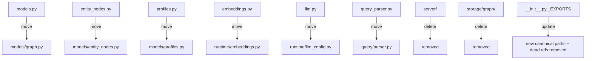

# Design Document — Phase 1: Internal Package Restructuring

## Overview

Phase 1 restructures the `context_graph/` Python package internals without changing any business logic. The goals are:

1. **Consolidate scattered data models** (`models.py`, `entity_nodes.py`, `profiles.py`) into a `models/` sub-package
2. **Relocate misplaced modules** (`embeddings.py` → `runtime/`, `llm.py` → `runtime/`, `query_parser.py` → `query/`)
3. **Document compatibility shims** (`metadata.py`, `profile_vectors.py`) with explicit deprecation notices
4. **Remove dead references** from `__init__.py` (entries pointing to non-existent `episodes`, `episode_processor`, `legacy_graph_backend`, `graph_read`)
5. **Remove empty packages** (`server/`, `storage/graph/`)
6. **Add docstrings** to all `__init__.py` files
7. **Update `_EXPORTS`** in the top-level `__init__.py` to reflect new canonical paths while preserving backward compatibility

All changes are purely organizational. No runtime behavior changes. Every existing `from context_graph import X` must continue to work.

## Architecture

### Current Layout (relevant files)

```
context_graph/
├── __init__.py          # ~60 lazy exports, some pointing to dead modules
├── models.py            # CanonicalNode, CanonicalEdge, GraphSnapshot, etc.
├── entity_nodes.py      # EntityNode and helpers
├── profiles.py          # ProfileRecord, ProfileDeactivation, factory functions
├── embeddings.py        # EmbeddingSettings, EmbeddingProvider, load/make helpers
├── llm.py               # EpisodeLLMSettings, load/make helpers
├── query_parser.py      # QueryParser, QueryParseResult, QueryAnchor
├── metadata.py          # Compatibility shim → storage.backend.metadata
├── profile_vectors.py   # Shim re-exports + service classes (ProfileSearchService, etc.)
├── cli.py               # CLI entry point (references episode_processor, graph_read)
├── server/              # Empty package (only __init__.py, which is empty)
├── storage/
│   ├── __init__.py      # Empty
│   ├── graph/           # Empty directory
│   └── backend/         # Real backend implementations
├── runtime/
│   ├── __init__.py      # Empty
│   ├── embedding/       # Bedrock/OpenAI embedder implementations
│   ├── llm/             # Bedrock/OpenAI LLM client implementations
│   └── providers/       # Factory helpers
├── query/
│   ├── __init__.py      # Exports code_graph query helpers
│   ├── code_graph.py
│   └── code_graph_types.py
├── ingestion/           # Snapshot building, diffing, driver
├── provenance/          # Observation/claim ontology
├── code_identity/       # Canonicalization and resolution
├── memory/              # Compatibility memory helpers
└── profiling/           # Performance profiling helpers
```

### Target Layout (Phase 1)

```
context_graph/
├── __init__.py          # Updated _EXPORTS with new canonical paths, dead refs removed
├── metadata.py          # Shim with COMPATIBILITY SHIM comment + deprecation docstring
├── profile_vectors.py   # Shim/service with COMPATIBILITY SHIM comment + dual-role docstring
├── cli.py               # Updated imports (runtime.embeddings, runtime.llm_config, query.parser)
├── models/              # NEW sub-package
│   ├── __init__.py      # Re-exports all public symbols from child modules
│   ├── graph.py         # Was models.py (CanonicalNode, CanonicalEdge, GraphSnapshot, etc.)
│   ├── entity_nodes.py  # Was entity_nodes.py (EntityNode and helpers)
│   └── profiles.py      # Was profiles.py (ProfileRecord, ProfileDeactivation, etc.)
├── runtime/
│   ├── __init__.py      # Docstring + re-exports from embeddings.py and llm_config.py
│   ├── embeddings.py    # Was context_graph/embeddings.py
│   ├── llm_config.py    # Was context_graph/llm.py (avoids collision with runtime/llm/)
│   ├── embedding/       # Unchanged
│   ├── llm/             # Unchanged
│   └── providers/       # Unchanged
├── query/
│   ├── __init__.py      # Updated: also re-exports QueryParser, QueryParseResult, QueryAnchor
│   ├── parser.py        # Was context_graph/query_parser.py
│   ├── code_graph.py    # Unchanged
│   └── code_graph_types.py  # Unchanged
├── storage/
│   ├── __init__.py      # Docstring added (no longer empty)
│   └── backend/         # Unchanged
│   (graph/ directory REMOVED)
├── (server/ directory REMOVED)
├── ingestion/           # Unchanged (docstrings added to __init__.py if missing)
├── provenance/          # Unchanged (docstrings added to __init__.py if missing)
├── code_identity/       # Unchanged (already has docstring)
├── memory/              # Unchanged (already has docstring)
└── profiling/           # Unchanged (already has docstring)
```

### Migration Strategy



## Components and Interfaces

### 1. models/ Sub-Package

**New file: `context_graph/models/__init__.py`**

Re-exports every public symbol from the three child modules so that `from context_graph.models import CanonicalNode` continues to work unchanged.

```python
"""Core data model definitions for the context graph.

This sub-package consolidates graph snapshot models, entity node helpers,
and profile record types into a single location.
"""

from .graph import (
    CanonicalEdge, CanonicalNode, EdgeChange, GraphSnapshot,
    JsonDict, NodeChange, SnapshotApplyResult, SnapshotDiff,
    canonical_json, utc_now_iso,
)
from .entity_nodes import (
    EntityNode, entity_node_aliases, entity_node_file_path,
    entity_node_kind, entity_node_qualified_name,
    entity_node_searchable_terms, make_entity_node,
)
from .profiles import (
    CLAIM_TARGET_KIND, FACT_EDGE_TARGET_KIND, OBSERVATION_TARGET_KIND,
    PROFILE_KEY_ORIGIN_GENERATED_SEMANTIC, PROFILE_KEY_ORIGIN_LEGACY_KEYWORD,
    PROFILE_KEY_ORIGIN_RAW_TEXT, ProfileDeactivation, ProfileKeyDefinition,
    ProfileRecord, RelationProfileSpec, SEMANTIC_CLAIM_PROFILE_KIND,
    SEMANTIC_FACT_PROFILE_KIND, SEMANTIC_OBSERVATION_PROFILE_KIND,
    SEMANTIC_RELATION_PROFILE_KIND,
    # factory functions
    observation_profile_text, profile_deactivation_from_fact_invalidation,
    semantic_claim_profile_from_claim, semantic_fact_profile_from_fact,
    semantic_observation_profile_from_observation,
    semantic_relation_profile_from_spec,
)
```

**File moves:**
| Old Path | New Path |
|---|---|
| `context_graph/models.py` | `context_graph/models/graph.py` |
| `context_graph/entity_nodes.py` | `context_graph/models/entity_nodes.py` |
| `context_graph/profiles.py` | `context_graph/models/profiles.py` |

**Internal import updates in moved files:**
- `profiles.py` currently does `from .entity_nodes import ...` and `from .models import canonical_json`. After the move to `models/profiles.py`, these become `from .entity_nodes import ...` (same-package) and `from .graph import canonical_json`.
- `profiles.py` also has `from .episodes import EntityEdge, FactInvalidation` under `TYPE_CHECKING`. Since `episodes.py` doesn't exist, this import is already guarded and uses `Any` at runtime. After the move, this becomes `from context_graph.episodes import ...` (still non-existent, still guarded). We leave this as-is since it's a TYPE_CHECKING-only reference to a dead module.

### 2. Runtime Module Relocation

**File moves:**
| Old Path | New Path | Rationale |
|---|---|---|
| `context_graph/embeddings.py` | `context_graph/runtime/embeddings.py` | Co-locate with `runtime/embedding/` providers |
| `context_graph/llm.py` | `context_graph/runtime/llm_config.py` | Co-locate with `runtime/llm/` clients; name avoids collision with `runtime/llm/` directory |

**`context_graph/runtime/__init__.py` updates:**

```python
"""Runtime configuration, provider factories, and client wrappers.

Sub-packages:
- embedding/: Embedding client implementations (Bedrock, OpenAI)
- llm/: LLM client implementations (Bedrock, OpenAI)
- providers/: High-level factory helpers for database and AI providers
"""

from .embeddings import (
    EmbeddingProvider, EmbeddingSettings,
    load_embedding_settings, make_embedding_provider,
)
from .llm_config import (
    EpisodeLLMSettings, load_episode_llm_settings, make_episode_llm_client,
)
```

**Internal import updates in moved files:**
- `embeddings.py` uses `from .runtime.embedding.openai import ...` and `from .runtime.embedding.bedrock import ...`. After moving to `runtime/embeddings.py`, these become `from .embedding.openai import ...` and `from .embedding.bedrock import ...`.
- `llm.py` uses `from .runtime.llm.config import LLMConfig`, `from .runtime.llm.openai_client import ...`, `from .runtime.llm.bedrock_client import ...`. After moving to `runtime/llm_config.py`, these become `from .llm.config import ...`, `from .llm.openai_client import ...`, `from .llm.bedrock_client import ...`.

### 3. Query Parser Relocation

**File move:**
| Old Path | New Path |
|---|---|
| `context_graph/query_parser.py` | `context_graph/query/parser.py` |

**`context_graph/query/__init__.py` updates:**

```python
"""Reusable query helpers and response shapes for deterministic retrieval."""

from .code_graph import (
    CodeGraphQueryError, get_code_graph_schema, get_code_snippet,
    load_latest_snapshot, search_code_graph, trace_call_path,
)
from .parser import QueryAnchor, QueryParseResult, QueryParser

__all__ = [
    "CodeGraphQueryError", "QueryAnchor", "QueryParseResult", "QueryParser",
    "get_code_graph_schema", "get_code_snippet", "load_latest_snapshot",
    "search_code_graph", "trace_call_path",
]
```

### 4. Consumer Import Updates

The following files import from the old paths and must be updated:

| File | Old Import | New Import |
|---|---|---|
| `cli.py` | `from .embeddings import ...` | `from .runtime.embeddings import ...` |
| `cli.py` | `from .llm import ...` | `from .runtime.llm_config import ...` |
| `cli.py` | `from .query_parser import QueryParser` | `from .query.parser import QueryParser` |
| `cli.py` | `from .models import utc_now_iso` | `from .models.graph import utc_now_iso` (or `from .models import utc_now_iso` via re-export) |
| `profile_vectors.py` | `from .embeddings import EmbeddingProvider` | `from .runtime.embeddings import EmbeddingProvider` |
| `profile_vectors.py` | `from .query_parser import ...` | `from .query.parser import ...` |
| `profile_vectors.py` | `from .profiles import ...` | `from .models.profiles import ...` |
| `provenance/claim_retrieval.py` | `from context_graph.query_parser import ...` | `from context_graph.query.parser import ...` |
| `provenance/claim_retrieval.py` | `from context_graph.embeddings import ...` | `from context_graph.runtime.embeddings import ...` |
| `provenance/claim_retrieval.py` | `from context_graph.profiles import ...` | `from context_graph.models.profiles import ...` |
| `ingestion/git/github_indexer.py` | `from context_graph.query_parser import ...` | `from context_graph.query.parser import ...` |
| `ingestion/git/github_indexer.py` | `from context_graph.metadata import ...` | `from context_graph.storage.backend.metadata import ...` |
| `ingestion/commit_indexing.py` | `from context_graph.query_parser import ...` | `from context_graph.query.parser import ...` |
| `storage/backend/metadata/store.py` | `from context_graph.models import ...` | `from context_graph.models.graph import ...` |
| `storage/backend/metadata/store.py` | `from context_graph.profiles import ...` | `from context_graph.models.profiles import ...` |
| `storage/backend/profile_vectors/store.py` | `from context_graph.profiles import ...` | `from context_graph.models.profiles import ...` |
| `provenance/*.py` (multiple) | `from context_graph.models import ...` | `from context_graph.models.graph import ...` |
| `provenance/*.py` (multiple) | `from context_graph.profiles import ...` | `from context_graph.models.profiles import ...` |
| `profiling/selected_functions.py` | `from context_graph.models import ...` | `from context_graph.models.graph import ...` |
| `profiling/selected_functions.py` | `from context_graph.metadata import ...` | `from context_graph.storage.backend.metadata import ...` |
| `query/code_graph.py` | `from context_graph.models import ...` | `from context_graph.models.graph import ...` |
| `code_identity/resolver.py` | `from context_graph.models import ...` | `from context_graph.models.graph import ...` |

**External consumers** (`mcp_server/`, `tests/`) that import via `from context_graph.X import Y` will continue to work because:
- The top-level `__init__.py` `_EXPORTS` will be updated to point to new canonical paths
- The `models/__init__.py` re-exports everything, so `from context_graph.models import CanonicalNode` still works
- Shim modules (`metadata.py`, `profile_vectors.py`) remain in place

### 5. Compatibility Shims

**`context_graph/metadata.py`** — already a pure re-export shim. Add:
```python
# COMPATIBILITY SHIM — do not add new code here.
"""Compatibility shim for metadata storage.

.. deprecated::
    Import directly from ``context_graph.storage.backend.metadata`` instead.
    This module exists only to preserve the historical import path
    ``from context_graph.metadata import MetadataStore``.

Canonical location: ``context_graph.storage.backend.metadata``
"""
```

**`context_graph/profile_vectors.py`** — dual-role module (re-exports storage types AND defines service classes). Document the dual role:
```python
# COMPATIBILITY SHIM (partial) — storage type re-exports are shims.
"""Profile vector search services and compatibility re-exports.

This module serves two purposes:
1. **Service layer**: Defines ProfileSearchService, ProfileVectorIndexer,
   SemanticProvenanceSearchService, and related service classes.
2. **Compatibility shim**: Re-exports storage types (ProfileVectorStore,
   ProfileKeyRecord, ProfileVectorHit, etc.) from their canonical location
   at ``context_graph.storage.backend.profile_vectors``.

For storage types, prefer importing from ``context_graph.storage.backend.profile_vectors``.
"""
```

### 6. Dead Reference Cleanup

The following `_EXPORTS` entries in `__init__.py` reference modules that do not exist on disk:

| Symbol | Module Path | Status |
|---|---|---|
| `BaseCypherExecutor` | `.legacy_graph_backend` | **REMOVE** — module does not exist |
| `CypherStatement` | `.legacy_graph_backend` | **REMOVE** — module does not exist |
| `GraphitiNeo4jExecutor` | `.legacy_graph_backend` | **REMOVE** — module does not exist |
| `GraphitiNeptuneExecutor` | `.legacy_graph_backend` | **REMOVE** — module does not exist |
| `Neo4jGraphSink` | `.legacy_graph_backend` | **REMOVE** — module does not exist |
| `NeptuneGraphSink` | `.legacy_graph_backend` | **REMOVE** — module does not exist |
| `EntityEdge` | `.episodes` | **REMOVE** — module does not exist |
| `EntityNode` | `.episodes` | **REMOVE** — `EntityNode` is re-exported from `.entity_nodes`; update to `.models.entity_nodes` |
| `EpisodicNode` | `.episodes` | **REMOVE** — module does not exist |
| `MentionRecord` | `.episodes` | **REMOVE** — module does not exist |
| `EpisodeBatchResult` | `.episode_processor` | **REMOVE** — module does not exist |
| `EpisodeProcessor` | `.episode_processor` | **REMOVE** — module does not exist |
| `EpisodeWorkItem` | `.episode_processor` | **REMOVE** — module does not exist |
| `GraphReadRepository` | `.graph_read` | **REMOVE** — module does not exist |

Note: `EntityNode` from `.episodes` should be replaced with an entry pointing to `.models.entity_nodes` since `EntityNode` is a real class that exists in `entity_nodes.py`.

### 7. Updated `_EXPORTS` Dictionary

After all moves and dead-reference removal, the `_EXPORTS` dictionary updates:

```python
_EXPORTS: dict[str, tuple[str, str]] = {
    # models.graph (was .models)
    "CanonicalEdge": (".models.graph", "CanonicalEdge"),
    "CanonicalNode": (".models.graph", "CanonicalNode"),
    "EdgeChange": (".models.graph", "EdgeChange"),
    "GraphSnapshot": (".models.graph", "GraphSnapshot"),
    "NodeChange": (".models.graph", "NodeChange"),
    "SnapshotApplyResult": (".models.graph", "SnapshotApplyResult"),
    "SnapshotDiff": (".models.graph", "SnapshotDiff"),

    # models.entity_nodes (was .entity_nodes or .episodes)
    "EntityNode": (".models.entity_nodes", "EntityNode"),

    # models.profiles (was .profiles)
    "ProfileDeactivation": (".models.profiles", "ProfileDeactivation"),
    "ProfileRecord": (".models.profiles", "ProfileRecord"),
    "SEMANTIC_CLAIM_PROFILE_KIND": (".models.profiles", "SEMANTIC_CLAIM_PROFILE_KIND"),
    "SEMANTIC_FACT_PROFILE_KIND": (".models.profiles", "SEMANTIC_FACT_PROFILE_KIND"),
    "SEMANTIC_OBSERVATION_PROFILE_KIND": (".models.profiles", "SEMANTIC_OBSERVATION_PROFILE_KIND"),
    "SEMANTIC_RELATION_PROFILE_KIND": (".models.profiles", "SEMANTIC_RELATION_PROFILE_KIND"),

    # runtime.embeddings (was .embeddings)
    "EmbeddingProvider": (".runtime.embeddings", "EmbeddingProvider"),
    "EmbeddingSettings": (".runtime.embeddings", "EmbeddingSettings"),

    # query.parser (was .query_parser)
    "QueryAnchor": (".query.parser", "QueryAnchor"),
    "QueryParseResult": (".query.parser", "QueryParseResult"),
    "QueryParser": (".query.parser", "QueryParser"),

    # metadata shim (unchanged, but prefer canonical path)
    "AuroraMetadataStore": (".storage.backend.metadata", "AuroraMetadataStore"),
    "InMemoryMetadataStore": (".storage.backend.metadata", "InMemoryMetadataStore"),
    "RepoIndexState": (".storage.backend.metadata", "RepoIndexState"),
    "RepoSourceState": (".storage.backend.metadata", "RepoSourceState"),
    "SQLiteMetadataStore": (".storage.backend.metadata", "SQLiteMetadataStore"),

    # profile_vectors (service + shim, unchanged module path)
    "AuroraProfileVectorStore": (".profile_vectors", "AuroraProfileVectorStore"),
    "InMemoryProfileVectorStore": (".profile_vectors", "InMemoryProfileVectorStore"),
    "ProfileSearchResult": (".profile_vectors", "ProfileSearchResult"),
    "ProfileSearchService": (".profile_vectors", "ProfileSearchService"),
    "ProfileVectorHit": (".profile_vectors", "ProfileVectorHit"),
    "ProfileVectorIndexer": (".profile_vectors", "ProfileVectorIndexer"),
    "SemanticProvenanceSearchService": (".profile_vectors", "SemanticProvenanceSearchService"),

    # ingestion (unchanged)
    "CodebaseMemorySnapshotProducer": (".ingestion", "CodebaseMemorySnapshotProducer"),
    "CommitIndexResult": (".ingestion", "CommitIndexResult"),
    "CommitInfo": (".ingestion.git.git_metadata", "CommitInfo"),
    "DeterministicHostedIndexResult": (".ingestion", "DeterministicHostedIndexResult"),
    "GitHubApiClient": (".ingestion.git.github_client", "GitHubApiClient"),
    "GitHubIndexer": (".ingestion.git.github_indexer", "GitHubIndexer"),
    "GitHubRepoRef": (".ingestion.git.github_client", "GitHubRepoRef"),
    "GitHubRepoResolver": (".ingestion.git.github_client", "GitHubRepoResolver"),
    "GitHubSyncResult": (".ingestion.git.github_indexer", "GitHubSyncResult"),
    "GitMetadata": (".ingestion.git.git_metadata", "GitMetadata"),
    "HostedIndexRequest": (".ingestion", "HostedIndexRequest"),
    "IngestionDriver": (".ingestion", "IngestionDriver"),
    "RepoCacheManager": (".ingestion", "RepoCacheManager"),
    "TemporalGraphWriter": (".ingestion", "TemporalGraphWriter"),
    "diff_snapshots": (".ingestion", "diff_snapshots"),
}
```

### 8. Empty Package / Directory Removal

| Path | Action |
|---|---|
| `context_graph/server/` | Delete entire directory (empty `__init__.py`, no code) |
| `context_graph/storage/graph/` | Delete empty directory |

Verify no imports reference `context_graph.server` or `context_graph.storage.graph` (confirmed: none found).

### 9. Docstrings for `__init__.py` Files

Files needing docstrings added (those that currently lack one):

| File | Proposed Docstring |
|---|---|
| `context_graph/runtime/__init__.py` | `"""Runtime configuration, provider factories, and client wrappers."""` |
| `context_graph/storage/__init__.py` | `"""Persistence backends and metadata storage for the context graph."""` |
| `context_graph/ingestion/__init__.py` | `"""Git-aware codebase ingestion, snapshot building, and diffing."""` |
| `context_graph/runtime/embedding/__init__.py` | `"""Embedding client implementations for Bedrock and OpenAI."""` |
| `context_graph/runtime/llm/__init__.py` | `"""LLM client implementations for Bedrock and OpenAI."""` |
| `context_graph/runtime/providers/__init__.py` | `"""High-level factory helpers for database and AI provider construction."""` |
| `context_graph/ingestion/git/__init__.py` | `"""Git metadata extraction and GitHub integration for ingestion."""` |
| `context_graph/memory/prompts/__init__.py` | `"""Prompt message models and helpers for memory operations."""` |
| `context_graph/provenance/prompts/__init__.py` | `"""Prompt templates for provenance claim and evidence extraction."""` |
| `context_graph/models/__init__.py` | `"""Core data model definitions for the context graph."""` |

Files that already have docstrings (preserve as-is):
- `context_graph/__init__.py` ✓
- `context_graph/code_identity/__init__.py` ✓
- `context_graph/memory/__init__.py` ✓
- `context_graph/profiling/__init__.py` ✓
- `context_graph/provenance/__init__.py` ✓
- `context_graph/query/__init__.py` ✓
- `context_graph/storage/backend/__init__.py` ✓

### 10. cli.py Dead Code

`cli.py` contains `_make_episode_processor()` which imports from `.episode_processor` and `.graph_read` — both non-existent modules. This function is dead code. The refactoring should:
1. Remove or comment out `_make_episode_processor()` 
2. Remove the lazy imports of `EpisodeProcessor` and `GraphReadRepository` inside it

This is the only place in the codebase that references these dead modules at the source level (the `__init__.py` references are handled by dead reference cleanup).

## Data Models

No data model changes. All existing dataclasses, their fields, serialization methods (`to_dict`/`from_dict`), and type signatures remain identical. The only change is the file path where each class is defined.

Key models and their new locations:

| Model | Old Module | New Module |
|---|---|---|
| `CanonicalNode`, `CanonicalEdge`, `GraphSnapshot`, `SnapshotDiff`, `SnapshotApplyResult`, `NodeChange`, `EdgeChange` | `context_graph.models` | `context_graph.models.graph` |
| `EntityNode` | `context_graph.entity_nodes` | `context_graph.models.entity_nodes` |
| `ProfileRecord`, `ProfileDeactivation`, `ProfileKeyDefinition`, `RelationProfileSpec` | `context_graph.profiles` | `context_graph.models.profiles` |
| `EmbeddingSettings`, `EmbeddingProvider` | `context_graph.embeddings` | `context_graph.runtime.embeddings` |
| `EpisodeLLMSettings` | `context_graph.llm` | `context_graph.runtime.llm_config` |
| `QueryParser`, `QueryParseResult`, `QueryAnchor` | `context_graph.query_parser` | `context_graph.query.parser` |


## Correctness Properties

*A property is a characteristic or behavior that should hold true across all valid executions of a system — essentially, a formal statement about what the system should do. Properties serve as the bridge between human-readable specifications and machine-verifiable correctness guarantees.*

The restructuring introduces no new business logic, so correctness is defined entirely in terms of import resolution, symbol identity, and structural invariants.

### Property 1: All exported symbols are importable

*For any* symbol name in `context_graph.__all__`, importing that symbol via `getattr(context_graph, name)` shall succeed without `ImportError` or `AttributeError`, and the resulting object shall not be `None`.

**Validates: Requirements 5.1, 5.3, 5.4**

### Property 2: Old import paths resolve to the same objects as new canonical paths

*For any* symbol that was previously importable from an old module path (e.g., `context_graph.models`, `context_graph.entity_nodes`, `context_graph.profiles`, `context_graph.embeddings`, `context_graph.llm`, `context_graph.query_parser`), importing that symbol from the old path and from the new canonical path (e.g., `context_graph.models.graph`, `context_graph.models.entity_nodes`, `context_graph.models.profiles`, `context_graph.runtime.embeddings`, `context_graph.runtime.llm_config`, `context_graph.query.parser`) shall yield the exact same object (i.e., `old_obj is new_obj`).

**Validates: Requirements 1.6, 2.4, 3.3**

### Property 3: No circular imports

*For any* module in the `context_graph` package tree, importing that module shall not raise `ImportError` due to circular dependencies. Specifically, iterating over all `.py` files under `context_graph/` and calling `importlib.import_module` on each shall succeed.

**Validates: Requirements 1.1, 2.1, 3.1**

### Property 4: All __init__.py files have docstrings

*For any* `__init__.py` file in the `context_graph/` package tree (excluding `__pycache__`), the corresponding module's `__doc__` attribute shall be a non-empty string.

**Validates: Requirements 7.1, 7.3**

### Property 5: models/ sub-package re-exports all child symbols

*For any* public symbol (not starting with `_`) defined in `context_graph.models.graph`, `context_graph.models.entity_nodes`, or `context_graph.models.profiles`, that symbol shall also be importable from `context_graph.models` and shall be the same object.

**Validates: Requirements 1.1, 1.5**

### Property 6: _EXPORTS uses canonical paths over shim paths

*For any* entry in `context_graph.__init__._EXPORTS` whose symbol is also available from `context_graph.storage.backend.metadata`, the `_EXPORTS` module path shall point to `.storage.backend.metadata` (the canonical location) rather than `.metadata` (the shim).

**Validates: Requirements 4.4**

## Error Handling

Since Phase 1 is a pure restructuring with no new business logic, error handling focuses on migration safety:

1. **Import failures**: If any moved module has a broken relative import after relocation, Python raises `ImportError` at import time. The property-based tests (Properties 1–3) catch this immediately.

2. **Dead reference access**: If a consumer tries to import a removed symbol (e.g., `from context_graph import EpisodeProcessor`), the lazy `__getattr__` in `__init__.py` raises `AttributeError`. This is the correct behavior — the symbol was referencing non-existent code.

3. **Circular imports**: The file moves change the import graph. If a circular dependency is introduced, `ImportError` is raised. Property 3 validates this doesn't happen.

4. **Missing re-exports**: If the `models/__init__.py` or `query/__init__.py` forgets to re-export a symbol, downstream code gets `ImportError`. Properties 2 and 5 catch this.

No new exception types or error-handling code is needed. The restructuring should be transparent to all runtime error paths.

## Testing Strategy

### Property-Based Testing

Use `hypothesis` (already available in the Python ecosystem) for property-based tests. Each property test generates inputs from the set of known symbols/modules and verifies the invariant holds.

**Configuration:**
- Minimum 100 iterations per property test
- Each test tagged with: `# Feature: repo-refactor, Property {N}: {title}`

**Property test implementations:**

1. **Property 1 (All exported symbols importable)**: Generate symbol names by sampling from `context_graph.__all__`. For each, call `getattr(context_graph, name)` and assert no exception.

2. **Property 2 (Old paths = new paths)**: Define a mapping of `(old_module, symbol) → new_module`. For each pair, import from both paths and assert `old is new`.

3. **Property 3 (No circular imports)**: Collect all `.py` files under `context_graph/`, convert to module paths, and `importlib.import_module` each. Assert no `ImportError`.

4. **Property 4 (All __init__.py have docstrings)**: Walk the `context_graph/` directory tree, find all `__init__.py` files, import the corresponding module, and assert `module.__doc__` is a non-empty string.

5. **Property 5 (models/ re-exports)**: Collect public names from each child module of `models/`, then verify each is accessible via `context_graph.models` and is the same object.

6. **Property 6 (_EXPORTS canonical paths)**: Inspect `_EXPORTS` dict, filter entries whose symbols exist in `storage.backend.metadata`, and assert the module path is `.storage.backend.metadata`.

### Unit Tests (Examples and Edge Cases)

Complement the property tests with specific example-based checks:

- **File existence**: Assert `context_graph/models/graph.py` exists, `context_graph/models/entity_nodes.py` exists, etc.
- **File absence**: Assert `context_graph/server/` does not exist, `context_graph/storage/graph/` does not exist, old root-level files (`models.py`, `entity_nodes.py`, `profiles.py`, `embeddings.py`, `llm.py`, `query_parser.py`) do not exist.
- **Dead references removed**: Assert `"BaseCypherExecutor"`, `"EpisodeProcessor"`, `"GraphReadRepository"` etc. are not in `context_graph.__all__`.
- **Shim comments**: Assert `metadata.py` source contains `# COMPATIBILITY SHIM`.
- **Docstring content**: Assert `context_graph.storage.__doc__` is not empty.
- **CLI importability**: `import context_graph.cli` succeeds without error.
- **MCP server importability**: `import context_graph_mcp_server` (or its key modules) succeeds.

### Test Organization

All Phase 1 restructuring tests go in `tests/test_restructuring.py` (or `tests/test_phase1_restructuring.py`). This keeps them separate from existing functional tests.
