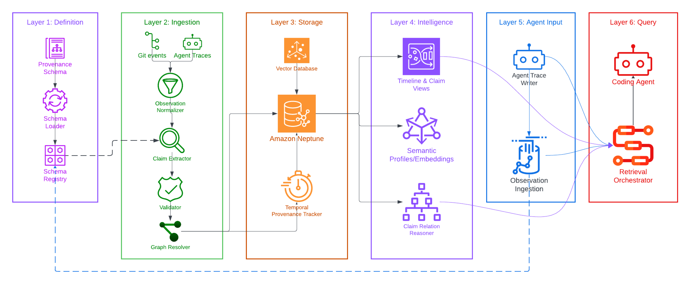

# Context Graph


Context Graph is a repository intelligence system that combines deterministic code indexing with claim-centric provenance retrieval for agent workflows.

## Architecture Overview



## Prerequisites

- **Python ≥ 3.12**
- **[uv](https://docs.astral.sh/uv/)** — fast Python package manager used for dependency management
- **Docker** — required for local infrastructure (Postgres, Neo4j, etc.)
- **make, a C11/C++17 compiler, and zlib development headers** — required to build the native indexer
- **OpenAI API key** — used by the default LLM and embedding configuration

## Repo Layout

- `context_graph/`: core library, ingestion pipeline, provenance pipeline, storage backends
- `mcp_server/`: standalone MCP app built on top of the core library
- `tests/`: core-library and compatibility tests
- `docs/`: architecture, ingestion, MCP, local dev, and deployment guides
- `infra/`: Terraform and deployment infrastructure
- `scripts/`: operational scripts and deploy helpers
- `tools/`: profiling utilities and developer tooling
- `evaluation/`: evaluation scaffold, runners, metrics, and gold datasets
- `graph_tests/`: graph correctness and ingestion pipeline tests
- `codebase_memory_pipeline/`: vendored C reference pipeline for codebase memory extraction

## Quick Start

Run these commands from the repository root. `uv run --no-sync` uses the environment installed below, so you do not need to activate it.

1. Install dependencies and create your local configuration:

```bash
uv sync --all-packages --dev --no-editable
cp .env.example .env
```

Set `OPENAI_API_KEY` in `.env` before continuing. The template configures Postgres on `localhost:5433` and Neo4j on `localhost:7687` with the credentials from `docker-compose.yml`. `CONTEXT_GRAPH_METADATA_DSN` configures the indexing CLI; `POSTGRES_DSN` points the MCP server at the same database. Both use 1536-dimensional OpenAI embeddings.

Use `--no-editable` to avoid the workspace editable-install `.pth` issue on Python 3.13. The commands below use `--no-sync` to preserve that installation.

2. Start local infrastructure and wait for both databases to be healthy:

```bash
docker compose up -d --wait
```

3. Index a repository:

```bash
uv run --no-sync --env-file .env python -m context_graph apply-latest-commit \
  /absolute/path/to/repo \
  --repo-id demo-repo \
  --metadata-backend postgres \
  --graph-backend neo4j \
  --execute
```

The CLI reads the database credentials and model settings from `.env`. On the first run, it builds `codebase_memory_pipeline/build/repo-graph-export` automatically.

4. Start the MCP server:

```bash
uv run --no-sync --env-file .env --package context-graph-mcp context-graph-mcp \
  --config mcp_server/config/config.yaml \
  --transport http
```

In another terminal, check the server:

```bash
curl -f http://localhost:8000/health
```

## Docs

- [Architecture](docs/architecture.md)
- [Ingestion](docs/ingestion.md)
- [MCP Server](docs/mcp.md)
- [Local Development](docs/local-dev.md)
- [Deployment](docs/deployment.md)
- [Provenance](docs/provenance.md)
- [Backend](docs/backend.md)
- [Ingestion Internals](docs/ingestion-internals.md)
- [Benchmarking](evaluation/MCP_RUN_GUIDE.md)

## Testing

Run the core test suite:

```bash
uv run --no-sync python -m pytest tests --cov=context_graph --cov-report=term-missing
```

Run the MCP app test suite:

```bash
PYTHONPATH=mcp_server uv run --no-sync python -m pytest mcp_server/tests
```

## Contributing

Contributions are welcome! To get started:

1. Fork the repository and create a feature branch.
2. Install dependencies with `uv sync --all-packages --dev --no-editable`.
3. Run the test suite with `uv run --no-sync python -m pytest tests` to make sure everything passes.
4. Open a pull request with a clear description of your changes.

Please keep pull requests focused and include tests for new functionality.

## License

This project does not yet include a LICENSE file. Please contact the maintainers for licensing information.
