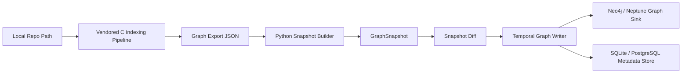

# Context Graph

This directory contains the current prototype of our **temporal context graph for coding agents**.

The main idea is to combine:

- a **deterministic code indexing pipeline** based on the vendored `codebase-memory-mcp` extractor
- a **temporal update layer** inspired by Graphiti
- pluggable **graph backends** for local development and production
- a separate **metadata store** for the latest snapshot and indexing bookkeeping

The project is intentionally split into two concerns:

1. **Code structure**
   - what files, folders, classes, functions, methods, and relations exist in a repository
2. **Time / provenance**
   - how that structure changes across revisions
   - how future provenance artifacts like commits, PRs, issues, and agent conversations will attach to the code graph

## What We Have Implemented So Far

### 1. Vendored indexing foundation from `codebase-memory-mcp`

We copied the parts of the upstream project that matter for indexing:

- discovery
- language support for a narrowed language set
- extraction engine
- graph buffer
- core indexing passes we care about

Relevant upstream-derived code lives under:

- `vendor/codebase_memory_pipeline/`

This includes a new exporter binary:

- `vendor/codebase_memory_pipeline/tools/repo_graph_export.c`

That binary now runs the vendored C pipeline and exports the graph buffer as JSON instead of dumping directly to SQLite.

### 2. Full snapshot building in Python

The Python snapshot layer reads the exported graph and converts it into a canonical in-memory snapshot:

- `GraphSnapshot`
- `CanonicalNode`
- `CanonicalEdge`

Relevant files:

- `context_graph/models.py`
- `context_graph/snapshot_builder.py`

This is the main boundary between:

- the **C indexing pipeline**
- and the **Python temporal/storage layer**

### 3. Temporal diffing and apply planning

We implemented a temporal writer that:

- loads the latest known snapshot
- diffs it against a new snapshot
- computes added / changed / removed nodes and edges
- emits version-aware graph writes

Relevant files:

- `context_graph/diffing.py`
- `context_graph/temporal.py`

### 4. Graph persistence planning

We implemented graph sinks for:

- **Neo4j** for local development
- **Neptune** for production-style openCypher execution

Relevant file:

- `context_graph/graph_sinks.py`

These sinks currently generate or execute Cypher statements that:

- create stable code nodes
- create version nodes
- invalidate old node versions
- invalidate old edges
- create new active structural edges

### 5. Metadata persistence

We implemented metadata storage for:

- in-memory tests
- SQLite
- PostgreSQL-compatible backends

Relevant file:

- `context_graph/metadata.py`

This metadata layer stores:

- the latest snapshot for a repository
- current nodes
- current edges
- index run history

This is important because the graph DB is used for temporal graph history, while the metadata DB keeps the **latest known active snapshot** for diffing future updates.

### 6. Local development setup

We added a local Docker-based setup for:

- PostgreSQL metadata storage
- Neo4j graph storage

Relevant files:

- `context_graph/docker-compose.local.yml`
- `context_graph/requirements-local.txt`
- `context_graph/LOCAL_DEV.md`

## Current Architecture



## Current Graph Model

### Code-layer nodes

The persisted graph currently stores code objects as:

- `(:CodeNode:Project)`
- `(:CodeNode:Folder)`
- `(:CodeNode:File)`
- `(:CodeNode:Module)`
- `(:CodeNode:Class)`
- `(:CodeNode:Function)`
- `(:CodeNode:Method)`

`CodeNode` is the common umbrella label. The specific label like `File` or `Function` is preserved too.

### Code-layer edges

Current edge types come from the exported upstream graph where available. In our current runs we have seen:

- `CONTAINS_FOLDER`
- `CONTAINS_FILE`
- `DEFINES`
- `DEFINES_METHOD`
- `CALLS`
- `TESTS`
- `USAGE`
- `WRITES`
- `THROWS`

Some edge types from the original project, such as `FILE_CHANGES_WITH`, depend on the current repository history and thresholds, so they will appear only when emitted by the upstream pass.

### Temporal augmentation

For each stable `CodeNode`, we create `CodeNodeVersion` nodes.

This means:

- `CodeNode` = stable identity
- `CodeNodeVersion` = what that node looked like at one revision

The link is:

- `(:CodeNode)-[:HAS_VERSION]->(:CodeNodeVersion)`

These version edges carry temporal fields such as:

- `valid_from_revision`
- `valid_to_revision`

Structural edges like `CALLS` and `DEFINES` are also stored with temporal metadata so older versions can be invalidated instead of deleted.

## How the Current Update Flow Works

Today, the update flow is:

1. Build a new snapshot from a local repository checkout.
2. Load the latest stored snapshot from the metadata store.
3. Diff old snapshot vs new snapshot.
4. For removed or changed nodes:
   - close the active `HAS_VERSION` relation
   - mark removed stable nodes inactive if needed
5. For removed or changed edges:
   - set `valid_to_revision`
6. For new or changed nodes:
   - create a new `CodeNodeVersion`
7. For new or changed edges:
   - create fresh active edges

This gives us a **temporal code graph** while still keeping a fast “current state” view.

## What Works Right Now

### Build a snapshot

```bash
python3 -m context_graph build-snapshot /path/to/repo --repo-id demo-repo --revision-id r1
```

This:

- runs the vendored C exporter
- builds a Python `GraphSnapshot`
- prints a summary

### Plan temporal updates

```bash
python3 -m context_graph plan-apply /path/to/repo --repo-id demo-repo --revision-id r1
```

This:

- builds a snapshot
- diffs it against the latest stored snapshot
- generates Cypher statements for the selected graph backend
- updates the metadata store

### Execute against local Neo4j and PostgreSQL

See:

- `context_graph/LOCAL_DEV.md`

At the moment, the easiest local stack is:

- PostgreSQL on `localhost:5433`
- Neo4j on `localhost:7687`

## What Is Still Missing

This is a working prototype, but it is not the full end-state system yet.

### 1. Commit-aware temporal updates

Right now, we can provide a `revision_id` manually and diff snapshots, but we do **not yet** have the full automated workflow for:

- detect new commit arrives
- re-run indexing on the new checkout
- map that commit to changed nodes/edges automatically
- attach first-class `Commit` nodes into the persisted graph

That is one of the most important next steps.

### 2. First-class provenance entities

We have focused on the **code graph + temporal update base layer** first.

We have **not yet** added first-class nodes for:

- `Commit`
- `PR`
- `Issue`
- `ConversationTurn`
- `Decision`
- `AgentNote`

These are planned, but they are not in the persisted graph yet.

### 3. Graphiti-style episode ingestion

We have not yet built the provenance / episode ingestion layer that would:

- store raw conversation or GitHub text as source nodes
- run LLM extraction on those episodes
- create decision / rationale / mention links
- attach those to the code graph

This is the next major layer after stabilizing the temporal code graph.

### 4. Production Aurora integration

We already have PostgreSQL-compatible metadata storage logic, but production Aurora support still needs:

- deployment wiring
- connection configuration through AWS infrastructure
- migration/bootstrap handling in a production environment
- integration with Lambda execution paths

So Aurora is **conceptually supported**, but not fully productionized yet.

### 5. Real Neptune production testing

We have a Neptune sink implementation, but the current end-to-end local development path is centered on Neo4j.

We still need:

- real Neptune environment validation
- authentication / networking validation in AWS
- performance testing for batch writes

## What We Want To Do Next

### Short-term next steps

1. **Test repeated indexing across new commits**
   - apply one revision
   - change the repo
   - index again
   - verify that the graph closes old versions and opens new ones correctly

2. **Add first-class `Commit` nodes**
   - connect commits to changed files/functions
   - use commits as the initial provenance anchor

3. **Improve temporal semantics**
   - verify that node and edge invalidation rules are correct
   - make point-in-time queries easier

4. **Harden PostgreSQL/Aurora metadata storage**
   - test against a real PostgreSQL instance more thoroughly
   - prepare for Aurora deployment

5. **Add provenance entities**
   - begin with `Commit`, `PR`, `Issue`
   - later add `ConversationTurn`, `Decision`, and `AgentNote`

### Medium-term next steps

1. **GitHub ingestion**
   - fetch PRs, issues, review comments, and timelines
   - connect them to commits and code nodes

2. **Episode ingestion for agent/user context**
   - store raw conversational text
   - extract useful semantic entities
   - attach them to code nodes

3. **Incremental webhook-driven updates**
   - GitHub push events
   - PR updates
   - issue changes
   - agent activity logs

4. **Production AWS integration**
   - Lambda orchestration
   - EFS-backed cloned repositories
   - Neptune + Aurora wiring

## Current Design Philosophy

The core design decision so far is:

- keep the **code graph deterministic**
- keep the **temporal layer explicit**
- add **LLM-driven provenance later**, not inside the code indexing path

That means:

- source code structure should come from parsing and graph extraction
- temporal history should come from diffing snapshots and invalidating outdated versions
- rationale / conversations / decisions should be layered on later as provenance

This separation keeps the current system simpler, more explainable, and easier to test.

## Testing Status

Current Python tests live in:

- `tests/test_context_graph.py`

They cover:

- snapshot building
- hidden-folder handling
- graph export parsing
- temporal diffing
- metadata round-trip
- Cypher planning for Neo4j and Neptune

The C exporter is also exercised indirectly through the CLI flow.

## Summary

So far, we have built the **base temporal code graph system**:

- vendored and adapted code indexing pipeline
- full graph export from C
- Python snapshot model
- temporal diff/apply logic
- local Neo4j execution path
- local PostgreSQL metadata path

The biggest remaining work is not the base graph anymore. The next phase is:

- testing update behavior across real commits
- adding provenance entities
- connecting GitHub and agent context into the graph
- hardening the AWS deployment path
